

  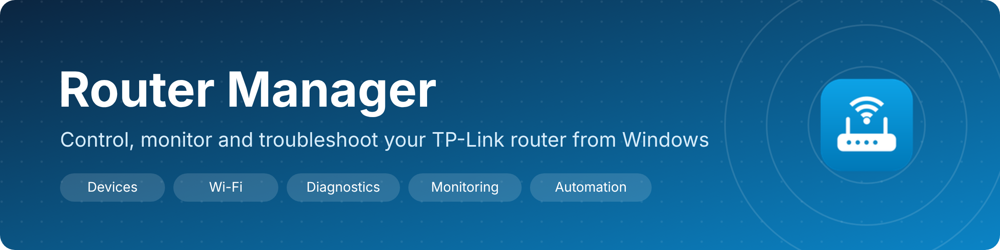

  
  
  
  

**Router Manager** is a desktop app for running your home or small-office TP-Link router: everything the router's own web page does, in a faster, clearer window, plus the tools a network administrator reaches for: diagnostics, a network scanner, monitoring with alerts, settings snapshots and scheduled automation.

  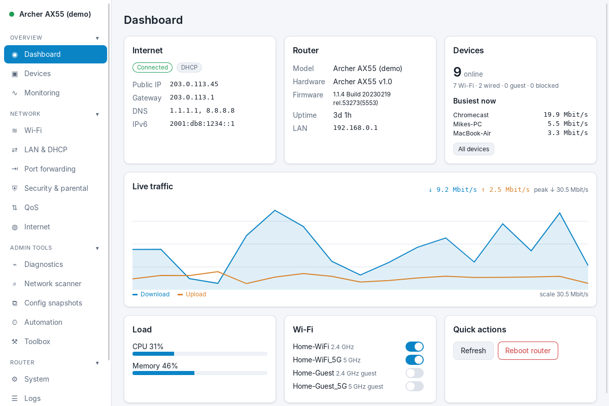

> **About the screenshots:** they were taken with the app's built-in **demo router**, not a real network. Every address, MAC, device name and Wi-Fi name in them is made up. The public IPs (`203.0.113.x`, `198.51.100.x`, `2001:db8::`) come from ranges reserved for documentation, so they can't belong to anyone.

---

## Contents

- [Download and install](#download-and-install)
- [Getting started in 2 minutes](#getting-started-in-2-minutes)
- [What you can do](#what-you-can-do)
- [A tour of the app](#a-tour-of-the-app)
- [How it works](#how-it-works)
- [Updates](#updates)
- [Privacy and security](#privacy-and-security)
- [Supported routers](#supported-routers)
- [Questions](#questions)

---

## Download and install

1. Download the installer: **[RouterManager_0.3.0_x64-setup.exe](https://github.com/MiMat82/Router-management-release/raw/main/downloads/v0.4.4/RouterManager_0.4.4_x64-setup.exe)**. If your browser blocks `.exe` downloads, take the **[.zip](https://github.com/MiMat82/Router-management-release/raw/main/downloads/v0.4.4/RouterManager_0.4.4_x64-setup.zip)** instead; it has the same file inside. Older versions are in [downloads](downloads).
2. Run it. If Windows SmartScreen shows *"Windows protected your PC"*, click **More info → Run anyway**. This happens because the installer isn't code-signed with a paid certificate yet. Updates *are* cryptographically signed (see [Updates](#updates)).
3. Start **Router Manager** from the Start menu.

| Requirement | |
|---|---|
| Operating system | Windows 10 or 11, 64-bit |
| Disk space | About 20 MB |
| Other | Microsoft Edge WebView2 (built into Windows 11; the installer fetches it on Windows 10 if missing) |

You install once. After that, new versions arrive inside the app.

---

## Getting started in 2 minutes

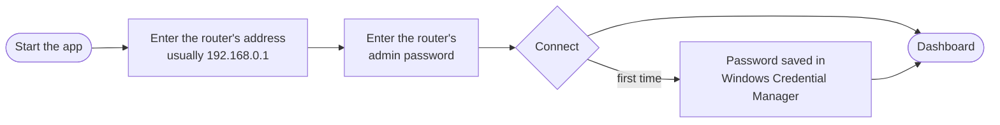

<table>
<tr>
<td width="50%">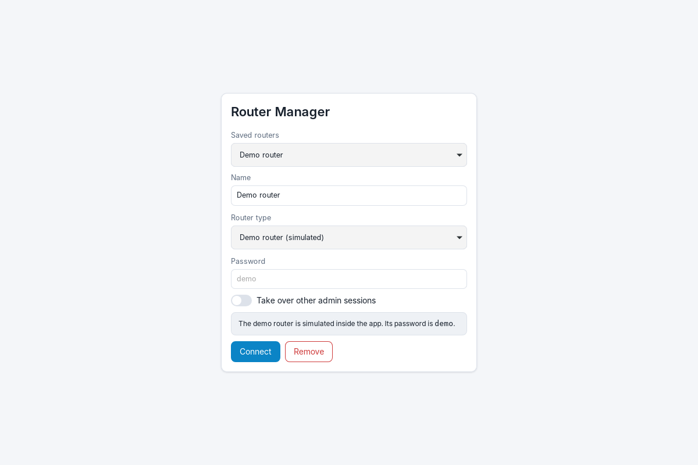</td>
<td>

**1. Add your router.** Give it a name, choose **TP-Link Archer (web login)**, and type the address you normally open in the browser (often `192.168.0.1`, `192.168.1.1` or `tplinkwifi.net`).

**2. Sign in** with the same admin password you use on the router's web page. Tick *Take over other admin sessions* if the router says someone else is logged in.

**3. Want to look around first?** Choose **Demo router (simulated)** with the password `demo`. Every screen works on a built-in pretend router, so nothing real changes.

</td>
</tr>
</table>

---

## What you can do

| Area | What it gives you |
|---|---|
| **Dashboard** | Internet status, public IP, router model and firmware, live traffic graph, CPU and memory, busiest devices, Wi-Fi quick switches, reboot |
| **Devices** | Every connected device with maker, device type, IP, signal and live speed. Search, filter, sort. Block or unblock, nickname, notes, "watch" a device, Wake-on-LAN, give it a fixed IP, prioritise it. CSV export |
| **Monitoring** | Traffic graph for each device, data usage per device per day, alert history, alert rules, Windows notifications |
| **Wi-Fi** | Every band and guest network: on/off, name, password with generator, security, channel, width, power, hidden. QR code to share, WPS, Wi-Fi schedule |
| **LAN & DHCP** | DHCP server, active leases, address reservations |
| **Port forwarding** | Rules, UPnP mappings, DMZ |
| **Security & parental** | Parental profiles (daily time limits, bedtime, blocked sites, pause internet), access control, firewall |
| **QoS** | Bandwidth limits and per-device priority |
| **Internet** | Connection type (DHCP, static, PPPoE), dynamic DNS, VPN server |
| **Diagnostics** | Ping with loss and jitter, traceroute, DNS lookup against five resolvers side by side, speed test with a bufferbloat grade |
| **Network scanner** | Finds every device on your network, including ones the router doesn't list. Shows maker, type and open ports, and includes a port scanner. CSV export |
| **Config snapshots** | Saves all router settings at a point in time (passwords masked) and shows exactly what changed between two snapshots, or since a snapshot |
| **Automation** | Weekly tasks: guest Wi-Fi on/off, a network on/off, block a device, wake a PC, LEDs, nightly snapshot, weekly reboot |
| **System** | Firmware check and install, reboot and reboot schedule, backup and restore, LEDs, admin password, time, factory reset |
| **Install OpenWrt** | Checks whether OpenWrt supports your exact model and hardware version, downloads the official image and verifies its checksum, saves your settings, and installs through the router's own upgrade page, with a recovery guide. Unsupported routers are refused |
| **Logs** | Router log with search, level filter and CSV export |
| **Toolbox** | Connection check, Wake-on-LAN, password generator, API explorer for advanced users |

Screens only appear for features your router actually reports, so you never press a button that can't work.

---

## A tour of the app

### Devices: who is on your network

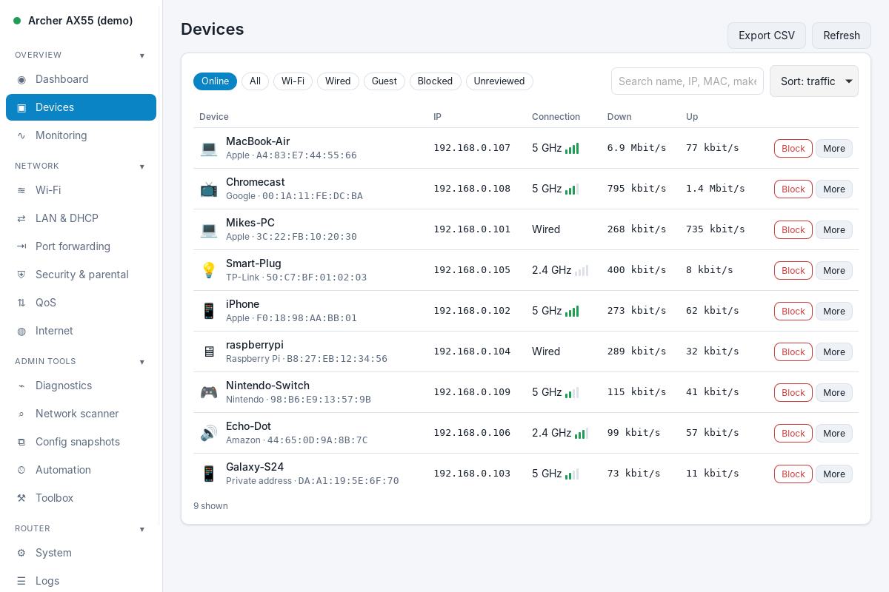

Each device shows its **maker** (from the official IEEE database), a **type guess** (phone, laptop, TV, console, smart plug and more), connection, signal and live speed. **More** opens the details and actions:

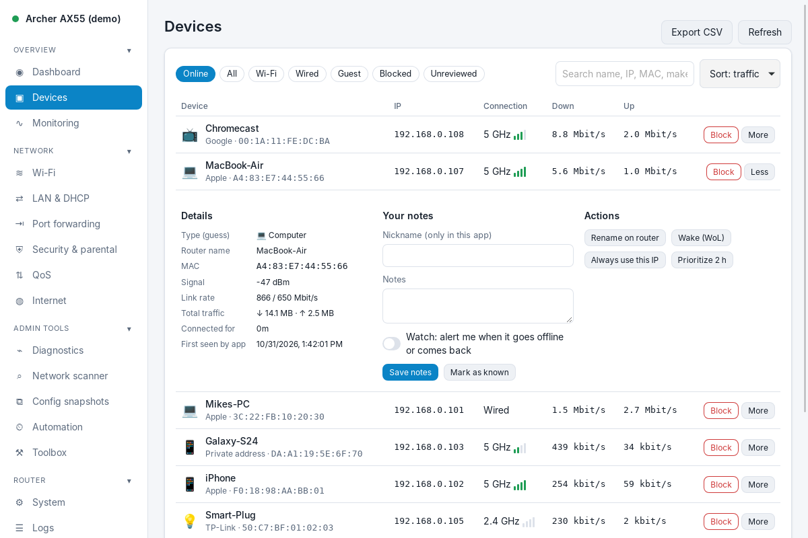

> **Tip:** switch on **Watch** for a child's tablet or a server and you get a notification when it goes offline or comes back.

### Monitoring and alerts

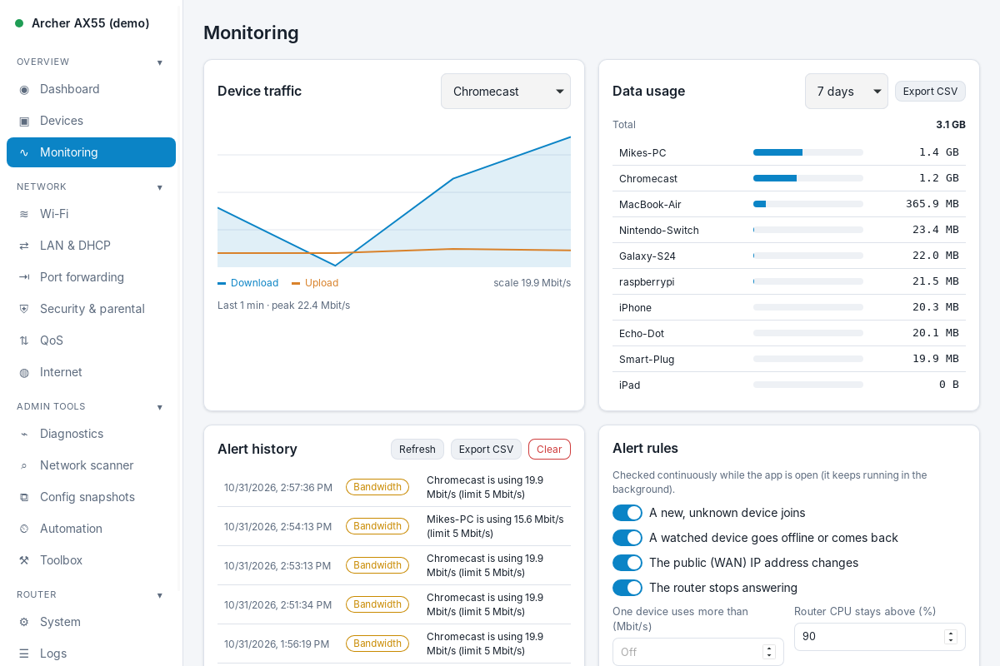

Pick any device to see its traffic over the last 30 minutes. **Data usage** adds up what every device downloaded and uploaded, per day, for up to two months. **Alert rules** decide what deserves your attention:

| Alert | When it fires |
|---|---|
| New device | An unknown device joins the network |
| Watched device | A device you watch goes offline or comes back |
| Public IP changed | Your internet provider gives you a new address |
| Router unreachable | The router stops answering, and again when it's back |
| Bandwidth | One device stays above the Mbit/s limit you set |
| High CPU | The router's CPU stays above the percentage you set |

### Diagnostics: find out why the internet is slow

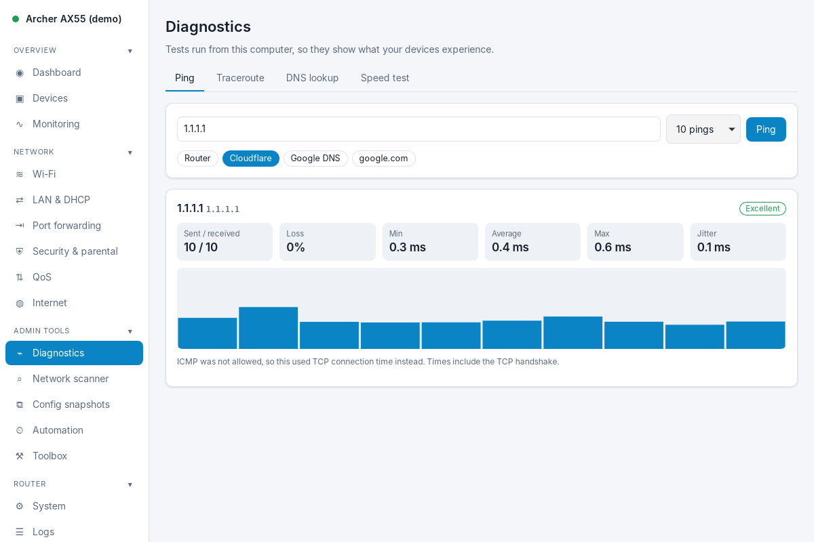

| Tool | Use it to |
|---|---|
| **Ping** | See delay, jitter and lost packets to the router or the internet, with a bar chart of every reply |
| **Traceroute** | See each hop between you and a server, and where delay starts |
| **DNS lookup** | Ask your computer, your router, Cloudflare, Google and Quad9 at the same time. Different answers reveal filtering or a broken DNS server |
| **Speed test** | Measure download, upload and latency under load. The **bufferbloat grade** (A+ to D) tells you whether turning on QoS would fix lag in calls and games |

### Config snapshots: see exactly what changed

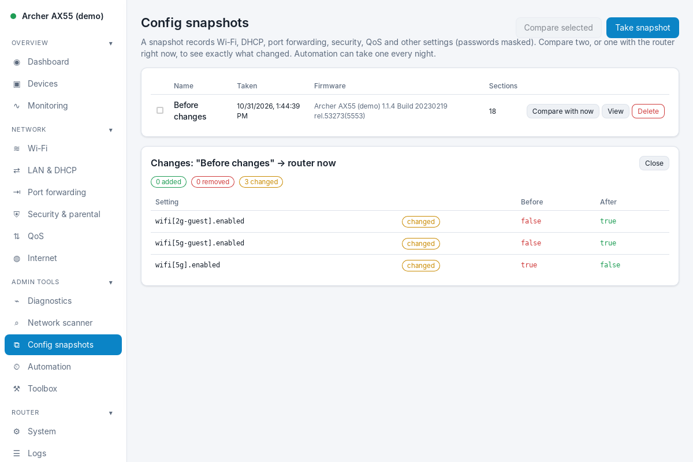

Take a snapshot before you change things, or let Automation take one every night. Compare any two snapshots, or a snapshot with the router right now, and every changed setting is listed with its old and new value.

### Automation

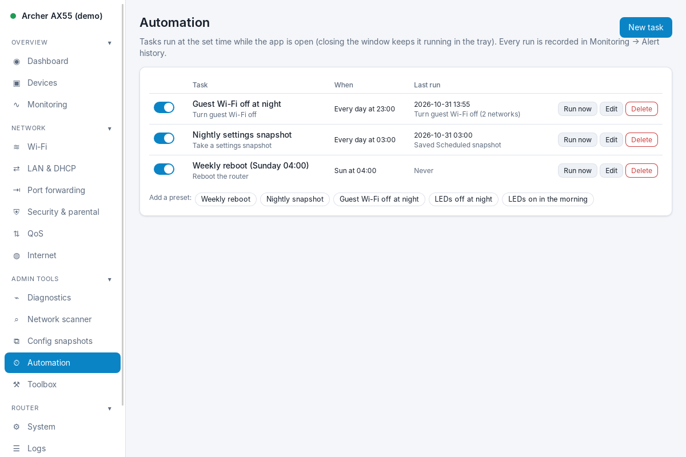

Schedule what you would otherwise do by hand. Start from a preset (*Weekly reboot*, *Nightly snapshot*, *Guest Wi-Fi off at night*, *LEDs off at night*) or build your own. Every run, and whether it worked, is recorded in the alert history.

> Close the window and the app keeps running in the system tray, so monitoring and automation continue. Right-click the tray icon and choose **Quit** to stop it.

### Wi-Fi, security and system

<table>
<tr>
<td width="50%">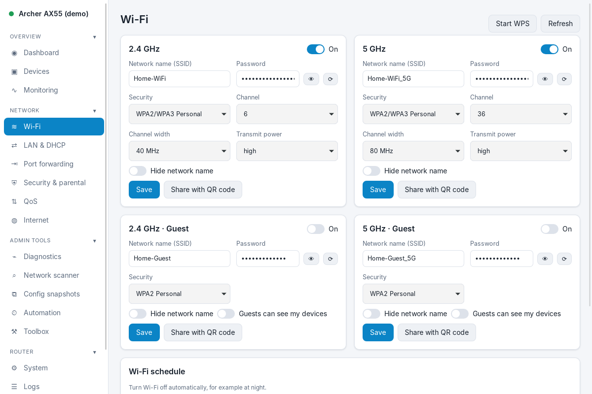 <b>Wi-Fi:</b> every band and guest network, with a QR code to share.</td>
<td width="50%">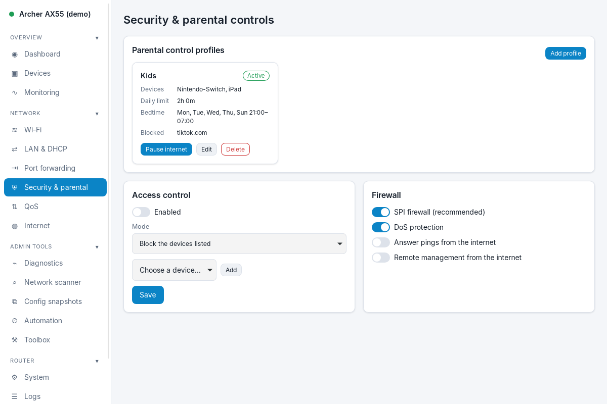 <b>Security & parental:</b> time limits, bedtime, blocked sites, pause.</td>
</tr>
<tr>
<td>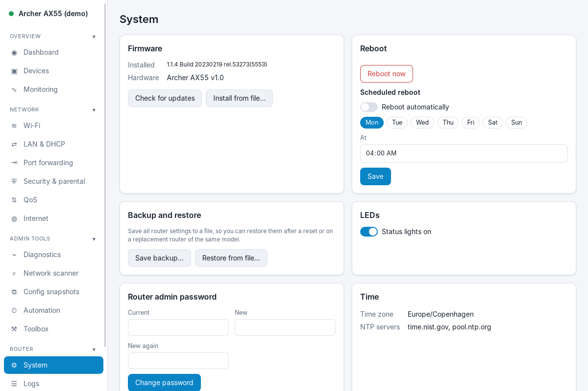 <b>System:</b> firmware, reboot schedule, backup and restore, LEDs.</td>
<td>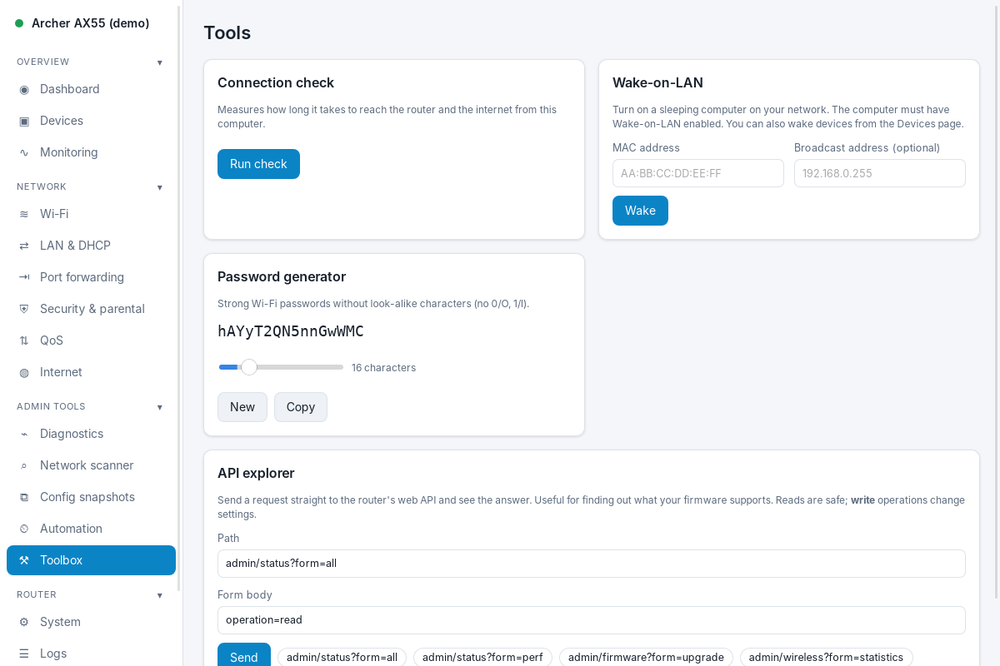 <b>Toolbox:</b> connection check, Wake-on-LAN, password generator.</td>
</tr>
</table>

The menu is grouped into **Overview**, **Network**, **Admin tools** and **Router**. Click a group's title to fold it away. The app remembers your choice.

---

## How it works

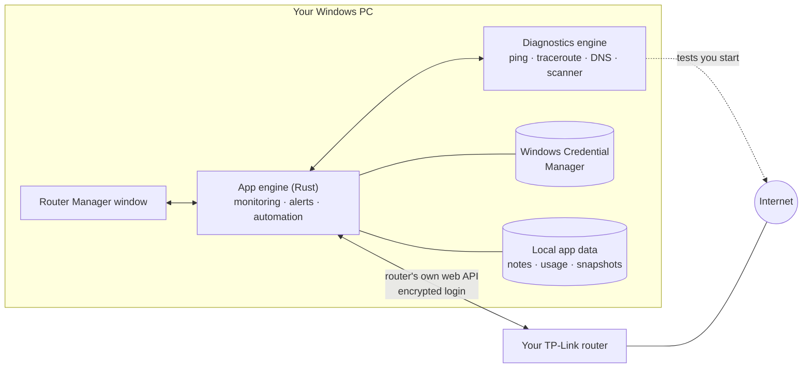

- The app talks **directly to your router** on your local network, using the same interface as the router's web page. No cloud account and no TP-Link app are needed.
- **Monitoring, alerts and automation** run in the app while it is open or in the tray.
- Diagnostics run **from your PC**, so they measure what your devices actually experience.

---

## Updates

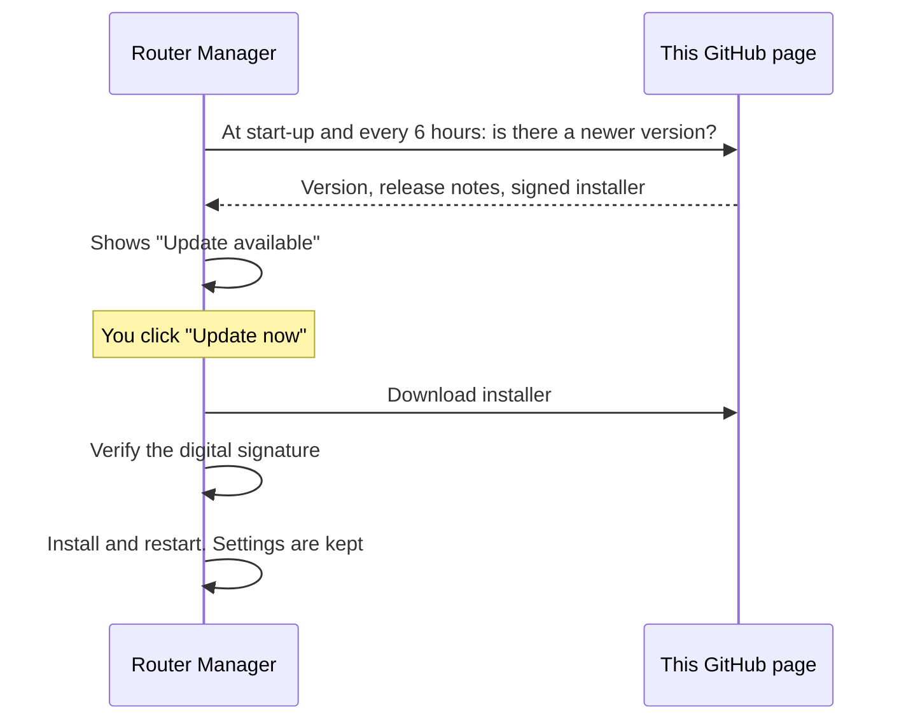

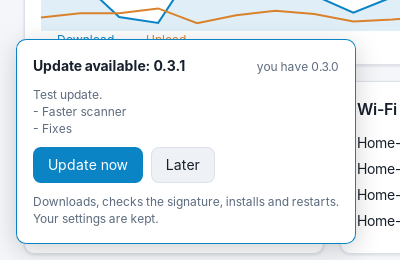

When a new version is published here, a small window appears in the app. Click **Update now**: it downloads, checks the signature, installs and restarts on its own. **Later** hides it until the next start.

Every update is signed with the project's private key, and the app refuses anything that doesn't match, so a tampered or fake download can't be installed.

You can check by hand, or turn automatic checks off, in **Settings → Updates**.

 

---

## Privacy and security

| | |
|---|---|
| **Your router password** | Stored in **Windows Credential Manager**, never in a plain file |
| **Where data goes** | Only to your router. Diagnostics you start yourself contact the servers you test (e.g. Cloudflare for the speed test). Update checks contact this GitHub page |
| **Tracking** | None. No accounts, no analytics, no telemetry |
| **Local data** | Device notes, usage history, alert history and snapshots stay in your Windows user profile |
| **Snapshots** | Wi-Fi and other passwords are masked before saving |
| **Updates** | Signed, and verified before they are installed |
| **Risky actions** | Reboot, factory reset, firmware install, restore and changing the internet connection always ask first |

---

## Supported routers

### Which routers work

| Router | Status | How to tell |
|---|---|---|
| **TP-Link Archer**, current web interface: Archer C6, C64, C80, A6, A7, AX10, AX20, AX21, AX23, AX50, AX55, AX73, AX3000 and similar models sold since about 2018 | **Supported.** Both the encrypted firmware (most current versions) and the older plain firmware | After you log in to the router in a browser, the address bar shows `…/cgi-bin/luci/;stok=…` |
| Demo router (built in) | Every feature, for trying the app safely | Password `demo` |
| TP-Link **Deco** mesh | Planned | Managed with the Deco phone app, no web login page |
| TP-Link **MR** 4G/LTE routers, older routers with the `userRpm` web page (e.g. TL-WR841N, early Archer C7/C50) | Planned | Address bar shows `…/userRpm/…` |
| Other brands (ASUS, Netgear, Linksys, ISP boxes) | Not supported | |

> **Honest status:** the Archer support is built from TP-Link's web interface and tested against a simulated router. It has not yet been checked on every model. If something on your model doesn't work, open an [issue](https://github.com/MiMat82/Router-management-release/issues) with your **model**, **hardware version** and **firmware version** (all three are on the Dashboard).

### What works on a supported Archer

| Area | On Archer routers |
|---|---|
| Dashboard, live traffic, CPU and memory | ✔ |
| Connected devices, block and unblock | ✔ |
| Wi-Fi (2.4 / 5 GHz) and guest networks | ✔ |
| DHCP, address reservations | ✔ |
| Port forwarding, UPnP, DMZ | ✔ |
| Firmware info and TP-Link update check, reboot, LEDs, system log | ✔ |
| API explorer | ✔ |
| QoS, parental controls, scheduled reboot, backup and restore, admin password | Varies by model and firmware. The app only shows what your router reports, so missing items are hidden rather than broken |

### What works with any network

These tools run on your PC and don't depend on the router brand: **ping, traceroute, DNS comparison, speed test with bufferbloat grade, network scanner, port scanner and Wake-on-LAN**. Monitoring, alerts, config snapshots and automation work on top of whatever your router supports.

The app opens after you connect to a router. If yours isn't supported yet, connect to the demo router and these tools still test your real network. A tools-only start without a router is planned.

### Computers

| Platform | Status |
|---|---|
| Windows 10 and 11 (64-bit) | Supported |
| Android | Planned |

---|---|
| TP-Link **Archer** routers with the modern web interface (address bar shows `…/cgi-bin/luci/…` after login), encrypted and older firmware | Supported. Features appear according to what your model reports |
| Demo router (built in) | Every feature, for trying the app safely |
| Deco mesh, MR (4G/LTE) routers, older routers with the `userRpm` interface | Planned |

Hardware support grows with each release. If something on your model doesn't work, open an [issue](https://github.com/MiMat82/Router-management-release/issues) with your **model**, **hardware version** and **firmware version** (all three are on the Dashboard).

---

## Questions

<b>Windows says "Windows protected your PC". Is it safe?</b>

That message appears for any installer that isn't signed with a paid code-signing certificate. Click **More info → Run anyway**. The in-app updates are signed and verified separately.

<b>I can't log in.</b>

Use the address and password you use for the router's web page. If the router allows only one admin at a time, close the browser tab that is logged in, or switch on <i>Take over other admin sessions</i>.

<b>Do I need to keep the app open for alerts and schedules?</b>

Yes, it has to be running, but it can be minimised to the tray. Closing the window doesn't stop it. Choose <b>Quit</b> from the tray icon to stop it.

<b>Will an update reset my settings?</b>

No. Saved routers, device notes, usage history, snapshots and tasks are kept.

<b>Why does ping say it used TCP?</b>

Some networks or security tools block ICMP (classic ping). The app then measures how long a TCP connection takes instead, which still shows delay and loss.

<b>How do I uninstall?</b>

Windows Settings → Apps → Router Manager → Uninstall.

---

Router Manager is an independent project and is not affiliated with or endorsed by TP-Link. TP-Link and Archer are trademarks of their respective owner.

